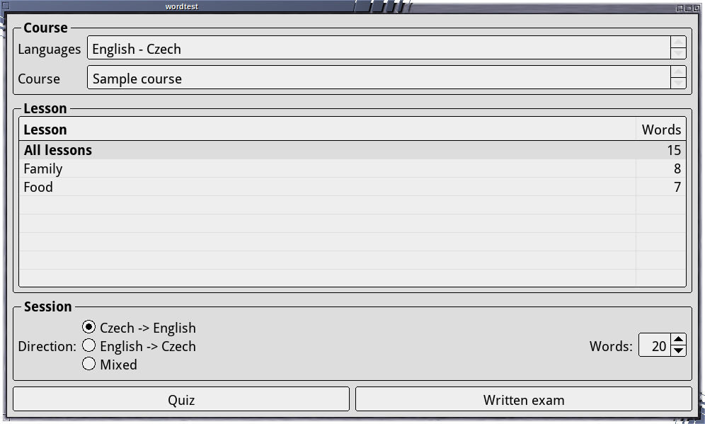
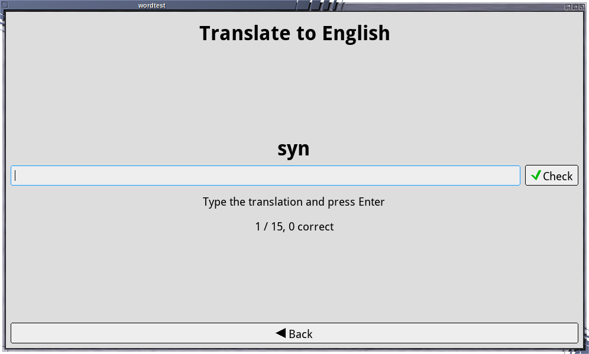
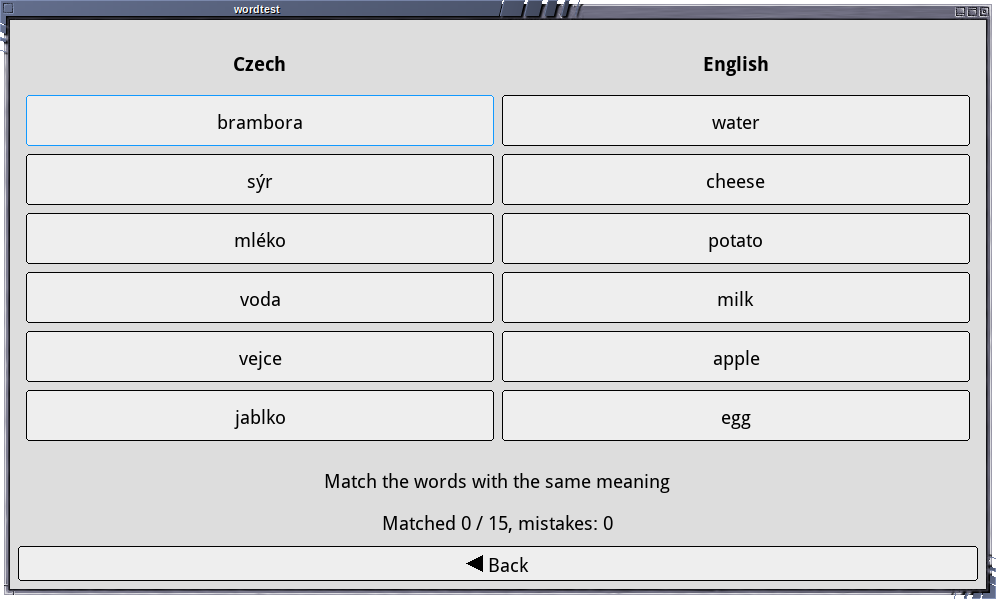

# Word test

A vocabulary test for language courses built with
[gfxprim](https://github.com/gfxprim/gfxprim) widgets.



The word lists are organized into language pairs, courses and lessons, which
are discovered automatically and selected in the main menu. Courses are plain
text files and can be packaged and installed separately from the application.

There are two modes of operation:

- **Written exam**: type the translation of the shown word. Words that were
  answered wrongly are asked again at the end until they are answered
  correctly, the score counts the first attempts only.



- **Quiz**: match words with the same meaning in two columns. Words come in
  rounds of six pairs, a correctly matched pair is disabled, a wrong pair is
  counted as a mistake.



Both modes can be done in either direction or with a randomly mixed one, and
the number of words per session can be limited, in which case the words are
picked randomly from the selected lesson(s). At the end a list of missed words
is shown.

## Building

The application depends on gfxprim and gfxprim-widgets libraries.

```
make
```

## Running

```
./wordtest
```

or, to test a single lesson file:

```
./wordtest path/to/lesson.txt
```

The language pair and the course are derived from the directory names if the
file is stored in the `pair/course/lesson.txt` structure.

The application is controlled by mouse or by keyboard, Tab / Shift+Tab or
Ctrl+arrows move the focus and Enter or Space press a button. In the written
exam the answer is checked by pressing Enter.

The last course selection in the main menu is stored in
`~/.config/wordtest/selection.txt`.

## Courses

### Directory layout

```
/usr/share/wordtest/
└── en-cz/                      <- language pair
    └── english-a1/             <- course
        ├── course.txt          <- optional, human readable course name
        ├── 01-family.txt       <- lesson
        ├── 02-food.txt
        └── 03-travel.txt
```

- **Language pair directory** (`en-cz`) names the two languages, in the same
  order as the columns in the lesson files. This sets the column headers and
  the direction choices. Other pairs, such as `de-cz`, work without code changes.
- **Course directory**: one per course package. For example, a package
  `wordtest-course-english-a1` installs `/usr/share/wordtest/en-cz/english-a1/`.
  Packages do not conflict because each owns its own directory.
- **Lesson files** (`*.txt`) are sorted by file name, so a numeric prefix sets
  their order. The menu shows the lesson name without the prefix and the
  extension. A `# title: Family` header line in the file overrides it.
- **`course.txt`** (optional) holds the course display name. Without it the
  directory name is used.

### Lesson file format

```
# title: Family
# english;czech  (order follows the language pair directory name)
dog;pes
car;auto, automobil
apple;jablko
```

- `;` separates the two languages.
- `,` separates alternative answers that are all accepted.
- `#` starts a comment.

Answers are compared with whitespaces trimmed and case ignored, everything
else, including diacritics, has to match exactly.

### Search path

The directories below are searched in this order and the results are merged.
When the same pair/course exists in more than one place, the earlier one wins.

1. `./courses/`: for development
2. `~/.local/share/wordtest/` (or `$XDG_DATA_HOME/wordtest/`): the user's own lessons
3. `/usr/local/share/wordtest/`
4. `/usr/share/wordtest/`

A small sample course is included in `courses/en-cz/sample/`, it is not
installed by `make install`.

## License

GPL-2.0-or-later
